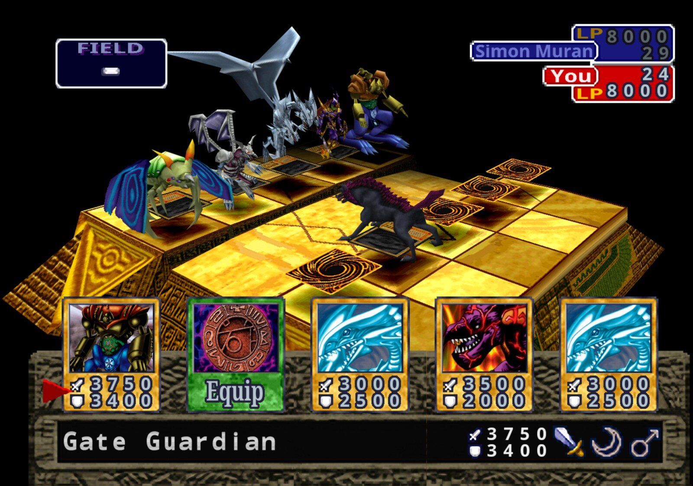

# Yu-Gi-Oh! Forbidden Memories — versão nativa para PC

Este projeto transforma o **Yu-Gi-Oh! Forbidden Memories** (PlayStation 1, versão americana)
em um jogo de **Windows** de verdade, sem emulador. O código do jogo foi decompilado e
recompilado para PC.

> **Importante:** o jogo **não vem junto**. Você precisa ter a sua própria cópia do jogo
> (um arquivo `.bin`). Este repositório só tem o código do programa.

> **Status:** experimental. As mudanças deste projeto (veja
> [O que este projeto muda](#o-que-este-projeto-muda)) ainda estão sendo testadas.



---

## Do que você precisa

- Um PC com **Windows 10 ou 11 (64 bits)**.
- **Internet na primeira vez** que abrir o jogo (ele baixa sozinho as ferramentas que precisa).
- Cerca de **2 GB livres** no disco.
- O arquivo **`.bin`** do jogo **Yu-Gi-Oh! Forbidden Memories (USA)** — código **SLUS-01411**.
  - Geralmente ele vem acompanhado de um arquivo `.cue` com o mesmo nome. Só o `.bin` é usado.
  - Versões europeias ou japonesas **não funcionam**.

Você **não** precisa instalar nada antes: nem Python, nem compilador. O próprio programa cuida disso.

---

## Como instalar e jogar (passo a passo)

### 1. Baixe este projeto

No topo desta página do GitHub, clique no botão verde **Code** e depois em **Download ZIP**.

Antes de extrair o ZIP: clique com o botão direito nele, vá em **Propriedades**, marque
**Desbloquear** (se aparecer) e clique em **OK**. Isso evita avisos do Windows mais tarde.

Extraia o ZIP para uma pasta fácil de achar, por exemplo `C:\Jogos\yfm-native`.

> Quem usa Git pode simplesmente rodar
> `git clone https://github.com/Luizhsampaio/yfm-native.git`.

### 2. Coloque o jogo na pasta `game`

Dentro da pasta do projeto, crie uma pasta chamada **`game`** (se ela ainda não existir) e
copie o seu arquivo **`.bin`** para dentro dela. O nome do arquivo não importa.

Deve ficar assim:

```
yfm-native\
   game\
      Yu-Gi-Oh! Forbidden Memories (USA).bin
   play.bat
   ...
```

### 3. Abra o jogo

Dê **dois cliques em `play.bat`**.

**A primeira vez demora** (de 5 a 15 minutos, dependendo do PC e da internet). Uma janela
preta vai mostrar o progresso. Nessa primeira vez o programa:

1. **Abre o seu `.bin`** e copia os arquivos do jogo para a pasta `game\disc`
   (leva poucos segundos e é feito só uma vez);
2. **Baixa as ferramentas** de que precisa (dentro da pasta `tmp`, sem instalar nada no Windows);
3. **Monta o jogo** para o seu PC;
4. **Abre o jogo.**

**Das próximas vezes**, é só dar dois cliques em `play.bat` de novo — abre em segundos.

### 4. (Opcional) Apague o `.bin`

Depois que o jogo abrir pela primeira vez, a pasta `game` vai ter o arquivo `yfm-disc.txt`
e a pasta `disc`. A partir daí o **`.bin` não é mais necessário** e pode ser apagado
(guarde uma cópia em outro lugar, se quiser).

Não apague nem mexa na pasta `game\disc` nem no `game\yfm-disc.txt`: é deles que o jogo lê.

---

## Controles

Dá para jogar com **teclado** ou **controle** (Xbox e compatíveis). Os controles podem ser
trocados no menu do jogo.

| PlayStation | Teclado | Controle Xbox |
|---|---|---|
| Direcionais | Setas | Direcional ou analógico esquerdo |
| ✕ (Xis) — confirmar | X | A |
| ◯ (Bola) — voltar | S | B |
| ▢ (Quadrado) | Z | X |
| △ (Triângulo) | A | Y |
| L1 / R1 | Q / W | LB / RB |
| L2 / R2 | E / R | LT / RT |
| Start | Enter | Menu/Start |
| Select | Shift direito | View/Back |

**Dica:** para ver a batalha em 3D, escolha o monstro alvo do ataque e confirme com
**Quadrado (tecla Z)** em vez de Xis.

### Menu do programa

Aperte **F10** para abrir a barra de menus. Nela você encontra, entre outras coisas:

- **Video > Resolution > Internal 4x** — gráficos mais nítidos;
- **Video > HD text** — textos em alta resolução;
- **Game > Mods** — ativar e desativar mods;
- **Game > Language** — idioma (os idiomas das versões europeias).

> O jogo pode avisar que existe uma "versão nova". Esse aviso é do **projeto original**
> (veja [Créditos](#créditos-e-licença)), não deste. Para desligar:
> **Help > Check for updates at start**.

---

## Saves (jogo salvo)

Os saves ficam em **`Documentos\My Games\YFM Re-Decomp\saves`**.

**Trazer o save de um emulador:** copie o arquivo de cartão de memória do emulador
(`.mcr`, `.mcd`, `.srm`, `.gme`, `.mcs`, `.psv`...) para essa pasta `saves`. Depois escolha
**LOAD** na tela inicial. (No DuckStation e no ePSXe esses arquivos ficam na pasta `memcards`.)
"Save states" de emulador não servem: salve dentro do jogo antes.

---

## Problemas comuns

**"O Windows protegeu o computador" (tela azul do SmartScreen)**
Clique em **Mais informações** e depois em **Executar assim mesmo**. Isso acontece porque o
programa é montado no seu PC e não tem assinatura digital.

**O antivírus bloqueia o jogo / "Acesso negado"**
Alguns antivírus (principalmente em computadores de empresa) bloqueiam programas recém-criados.
Em PC pessoal, adicione a pasta do projeto como exceção no antivírus. Em PC de empresa, fale
com o suporte de TI ou use outro computador.

**"Put your disc image in the game folder first"**
O programa não achou o jogo. Confira se:
- a pasta se chama exatamente `game` e está **dentro** da pasta do projeto (ao lado do `play.bat`);
- o arquivo dentro dela é o **`.bin`** (não o `.cue`).

**"this is not the Yu-Gi-Oh! Forbidden Memories (USA, SLUS-01411) disc"**
O `.bin` não é da versão americana do jogo. Só a versão USA (SLUS-01411) funciona.

**A janela preta mostra um erro e o jogo não abre**
- Na primeira vez, confira se o PC está conectado à internet e rode o `play.bat` de novo.
- Se o erro continuar, a janela mostra onde ficou o relatório do problema (pasta `tmp\pc`,
  arquivos `crash-...txt` e `last-session.log`). Abra uma *issue* aqui no GitHub e anexe esses arquivos.

**Quero atualizar o projeto**
Baixe o ZIP novo (ou rode `git pull`) e **copie a sua pasta `game` antiga para dentro dele**.
A pasta `game` nunca é substituída pela atualização.

---

## Avisos importantes

- **Não envie a pasta `game` para o GitHub nem compartilhe os arquivos do jogo.** Eles são
  da Konami. O projeto já está configurado para o Git ignorar essa pasta (arquivo `.gitignore`);
  não apague esse arquivo.
- Cada pessoa deve usar a sua própria cópia do jogo.

---

## O que este projeto muda

Este repositório parte do
[Yu-Gi-Oh! Forbidden Memories Recompiled](https://github.com/Unchiga/Yu-Gi-Oh-Forbidden-Memories-Recompiled)
e tem o objetivo de deixar o jogo **100% nativo**:

- **Animações de ataque dos monstros em código nativo.** No projeto original, as animações de
  ataque de cada monstro (código do PlayStation guardado no arquivo `MODEL.MRG`) rodavam num
  "mini emulador" embutido. Aqui elas são traduzidas automaticamente para C durante a montagem
  do jogo (`tools/pc/model_recomp.py`).
- **O jogo roda a partir de arquivos abertos, sem o `.bin`.** O `.bin` é aberto uma única vez
  e os arquivos do jogo vão para `game\disc` (`tools/pc/extract_disc.py`). Depois disso o `.bin`
  pode ser apagado.

Próximos passos planejados: converter os arquivos do jogo para formatos comuns (imagens PNG,
áudio, vídeo) e remover a dependência do mapa de memória do PlayStation.

---

## Para desenvolvedores

- Como o jogo é montado: [notes/pc-build.md](notes/pc-build.md)
  (inclui a seção sobre o disco extraído).
- Mods: [notes/modding.md](notes/modding.md) · FM Editor: [tools/pc/fm_editor/README.md](tools/pc/fm_editor/README.md)
- Comparar as animações traduzidas com o interpretador original:
  `python tools\pc\test_model_recomp.py`
- Decompilação: todas as funções do jogo batem byte a byte com o original
  (`make tools` e `make match`; veja [notes/setup.md](notes/setup.md)).

<details>
<summary>Progresso da decompilação</summary>

<!-- BEGIN GENERATED PROGRESS -->

| Metric | Current |
|---|---:|
| Game C-decompilation targets matched | **1,134 / 1,134 (100.00%)** |
| Game C-decompilation target bytes matched | **356,080 (`0x56EF0`) / 356,080 (`0x56EF0`) (100.00%)** |
| Remaining game C-decompilation targets | 0 functions, 0 (`0x0`) |
| Evidence-backed handwritten game assembly | 61 functions, 40,116 (`0x9CB4`) |
| Total game-owned functions | 1,195 |
| Preserved Psy-Q CRT/SDK assembly | 591 functions, 117,348 (`0x1CA64`) |
| Total discovered functions | 1,786 |
| Embedded/unassigned resident text | 1,780 (`0x6F4`) |

Runtime overlay modules:

| Module | Matching C functions | Matching C bytes |
|---|---:|---:|
| `free_duel` | 9 / 9 (100.00%) | 4,140 (`0x102C`) / 4,140 (`0x102C`) (100.00%) |
| `main_menu` | 31 / 31 (100.00%) | 17,724 (`0x453C`) / 17,724 (`0x453C`) (100.00%) |
| `overworld_after_coup` | 15 / 15 (100.00%) | 6,184 (`0x1828`) / 6,184 (`0x1828`) (100.00%) |
| `overworld_before_coup` | 15 / 15 (100.00%) | 6,184 (`0x1828`) / 6,184 (`0x1828`) (100.00%) |
| `password` | 27 / 27 (100.00%) | 10,884 (`0x2A84`) / 10,884 (`0x2A84`) (100.00%) |

_Generated from `config/slus_01411/functions.csv` and `config/slus_01411/overlays/*_functions.csv` by `tools/project/progress.py`._

<!-- END GENERATED PROGRESS -->

</details>

---

## Créditos e licença

- Port para PC original: [Unchiga e colaboradores](https://github.com/Unchiga/Yu-Gi-Oh-Forbidden-Memories-Recompiled),
  licença [MIT](LICENSE) (o aviso de copyright deles deve ser mantido).
- Decompilação: [memories-decomp](https://github.com/krystalgamer/memories-decomp), de seus autores.
- Detalhes em [NOTICE](NOTICE).
- **Yu-Gi-Oh!** e **Forbidden Memories** pertencem à **Konami**. Nenhum arquivo do jogo é
  distribuído aqui.